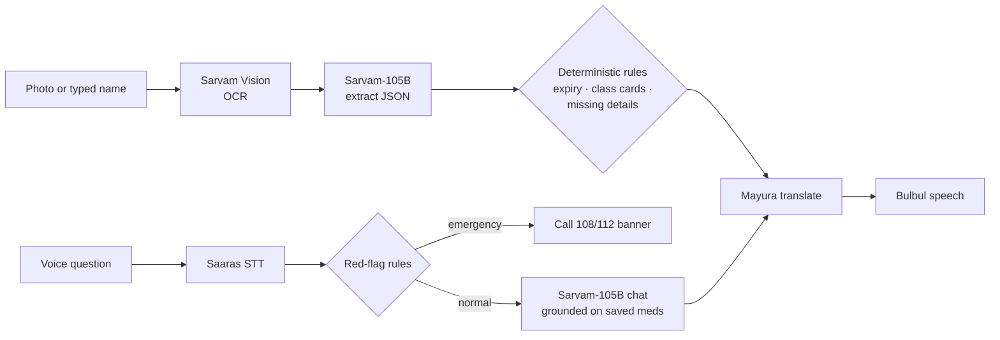

# Dawai Dekho · दवाई देखो

**Point your phone at a medicine strip. Hear, in your own language, what it is, whether it has expired, and what to watch out for.**

Built for the Sarvam AI buildathon on Sarvam Vision, Sarvam-105B, Saaras, Bulbul and Mayura.

> Not medical advice. Dawai Dekho never diagnoses and never gives dosing instructions. It reads what is printed on the pack, runs fixed safety rules, and always points people to a doctor or pharmacist.

---

## The problem

Millions of people in India take medicines they cannot read. The label is in small English print, the person may be elderly, visually impaired, or not literate, and the pharmacist may be far away. The result is real harm: expired strips taken, two painkillers combined, antibiotics used for a cold, and no idea what to do when something goes wrong.

## What it does

| | Feature | How |
|---|---|---|
| 📷 | **Scan a strip** (or type a name) | Sarvam Vision OCR → Sarvam-105B extracts name, ingredients, label text |
| 🔊 | **Speaks the answer** in 11 languages, with slow replay | Mayura translation + Bulbul text-to-speech |
| ⏳ | **Expiry verdict** (expired / not past / not found) | Deterministic regex parser, not the LLM |
| ⚠️ | **Drug-class cards** (antibiotic, steroid, NSAID, sedative, codeine) | Fixed, reviewed messages, translated and cached |
| 💬 | **Voice and text chatbot** in the user's language, aware of their saved medicines | Saaras STT → Sarvam-105B → Bulbul |
| 🚨 | **Emergency red-flag triage**: chest pain, snakebite, poisoning and more, in 10+ scripts | Rules run *before* the LLM and always win |
| 🆘 | **SOS screen**: 112 / 108 / 102 / Tele-MANAS, one-tap location share to family, eSanjeevani doctor link, nearest hospital/pharmacy | Works with no API call |
| 💊 | **My medicines**: daily checklist, in-app reminders, `.ics` calendar export, expiry badges | On-device storage |
| 🔁 | **Duplicate and interaction flags** across the saved list | Small curated table, never an LLM guess |
| 📤 | **WhatsApp share** of a result or the whole list with your doctor | `wa.me` links |
| 🌗 | Dark / light theme, three text sizes, installable PWA, language-first onboarding | Plain HTML/JS |

## How it works



**Design principle: the LLM explains, rules decide.** Anything safety-relevant (expiry, emergencies, interactions, antibiotic and steroid warnings) is deterministic code in [`knowledge.py`](knowledge.py), covered by unit tests. The model only extracts text and phrases answers.

### Safety guardrails
- Emergency detection runs before the model and over-triggers on purpose. If the LLM is down, the emergency path still works.
- When no label was read (typed name), directions and warnings are blanked so the model cannot present guesses as label text.
- Interactions come only from a small curated list. The app always says *"no warning does not mean safe."*
- Expiry says "not past", never "safe", and asks the user to confirm the date on the strip.
- A missing batch number, licence or MRP produces a *check with a chemist* prompt, never a "fake" verdict.
- Every result carries a spoken and written "not medical advice" line, and the raw OCR text is one tap away.

## Quick start

Requires Python 3.9+ and a Sarvam API key from <https://dashboard.sarvam.ai>.

```bash
git clone https://github.com/positron1253/sarvam-buildathon.git
cd sarvam-buildathon

cp .env.example .env          # Windows: copy .env.example .env
# edit .env and paste your SARVAM_API_KEY

pip install -r requirements.txt
python -m uvicorn server:app --port 8000
```

Open <http://localhost:8000>. Or run `start.bat` (Windows) / `./start.sh` (macOS, Linux), which do the same.

> The camera and microphone need `localhost` or HTTPS. To try it on a real phone, use an HTTPS tunnel (for example `cloudflared tunnel --url http://localhost:8000`).

### Try it without a browser: the demo script

```bash
python demo.py                  # Hindi
python demo.py --lang ta-IN     # Tamil (any of the 11 languages)
python demo.py --no-audio       # skip speech, saves credits
```

It scans the three images in [`samples/`](samples) (an expired strip, a painkiller, an antibiotic), prints the extracted data, expiry verdict, warnings and the translated spoken text, runs the interaction check, asks a normal question and an emergency one, and writes the audio to `demo_out/`. It costs roughly ₹5–8 of credits per run, and repeat runs are free thanks to caching.

You can also scan the sample images in the web app by choosing them from the gallery button.

### Tests (offline, no credits)

```bash
python -m unittest discover -s tests -v
```

Covers expiry parsing across label formats, emergency triggers in several languages (and no false alarms), duplicate and interaction rules, and drug-class cards.

## Cost control

A full scan with spoken reply is about ₹2–3 of Sarvam credits; a chat turn is about ₹1. To make a small balance last:
- Scan results, translations and speech are cached on disk by content hash.
- The server enforces a hard cap on paid calls per run (`BUDGET_UNITS`, default 400; one scan counts as 3). When it is reached, the app says so and the SOS screen keeps working.
- Reasoning is switched off on Sarvam-105B for extraction and chat (`reasoning_effort: null`) so answers are not eaten by hidden tokens.
- Images are downscaled in the browser before upload.

## Project layout

```
server.py        FastAPI app: scan, manual lookup, chat, STT, TTS, translation, spend guard
knowledge.py     Deterministic safety layer: red flags, expiry, class cards, interactions
static/          Single-page UI (no build step), service worker, manifest, icon
samples/         Sample strip images (regenerate with make_samples.py)
demo.py          One-command CLI demo of every Sarvam step
tests/           Offline unit tests for the safety layer
```

## Honest limitations

- OCR on curved or glary foil strips can fail. The app checks photo brightness and sharpness on-device and offers a typed-name fallback.
- Interaction checking covers a small curated list, not a full drug database.
- Browser reminders only ring while the app is open. For alarms with the app closed, use the exported calendar file or a phone alarm.
- Sarvam Vision is built for documents, so accuracy on real packaging should be validated on more photos than the samples included here.
- Translation quality for medical terms varies by language and should be reviewed by native speakers and a pharmacist before any real deployment.

## Roadmap
Barcode/QR batch lookup where public data exists, caregiver mode that pushes missed-dose alerts to family, ASHA-worker view for follow-up calls, and streaming speech for lower latency.

## Credits
Built with [Sarvam AI](https://www.sarvam.ai) APIs. Emergency numbers: 112 (national emergency), 108 / 102 (ambulance, availability varies by state), 14416 (Tele-MANAS), eSanjeevani national telemedicine service.
